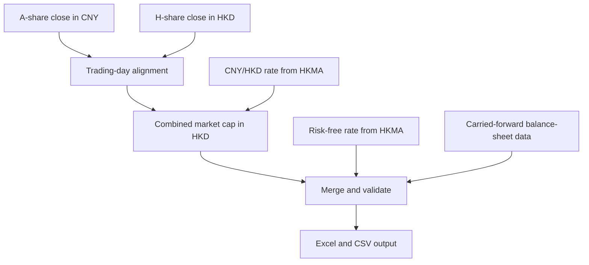

# Production-Oriented DTD Input Data Pipeline

The concise assessment report, including the Part 2 historical DTD review, is
available in [`REPORT.md`](REPORT.md). This README is the operational guide for
installing, running, and validating the code.

## 1. Project Overview

This project implements a production-oriented data pipeline for preparing daily input data for a Distance-to-Default (DTD) model.

The pipeline focuses on producing clean, complete, consistently structured, and incrementally updated input data. The calculation of the DTD model itself is not included.

For each new trading day, the pipeline prepares:

- Daily combined market capitalization of Vanke's A-shares and H-shares;
- Daily risk-free rate based on the Hong Kong Monetary Authority's 12-month Exchange Fund Bills yield;
- Balance-sheet variables carried forward from the latest valid observation when no new financial statements are released.

The implementation preserves all historical Input records and keeps the original historical DTD Output unchanged.

The main design priorities are:

- Clear separation between data ingestion, transformation, validation, and output;
- Explicit daily incremental processing;
- No modification of historical records;
- No use of future information in simulated daily runs;
- Transparent fallback handling for unavailable external data;
- Readable and maintainable code.

---

## 2. Pipeline Architecture

The pipeline is divided into four main stages:



### Stage 1: Data Ingestion

The pipeline obtains:

1. A-share and H-share closing prices;
2. The direct CNY/HKD exchange rate;
3. The 12-month HKMA Exchange Fund Bills yield;
4. The latest available balance-sheet variables from the existing Input data.

### Stage 2: Transformation

The pipeline:

1. Identifies valid trading dates;
2. Aligns the A-share and H-share trading calendars;
3. Carries forward the latest price when only one listing is closed;
4. Converts the A-share market value from CNY to HKD;
5. Calculates the combined A-share and H-share market capitalization;
6. Attaches the latest risk-free rate available on or before the trading date;
7. Carries forward balance-sheet variables.

### Stage 3: Consistency Checks

Before writing any official output, the pipeline checks:

- Column names and column order;
- Duplicate dates;
- Missing values;
- Date ordering;
- Company number consistency;
- Historical Input preservation;
- Historical Output preservation;
- Availability of all required daily inputs.

### Stage 4: Output Generation

The pipeline produces:

- An updated Excel workbook;
- A CSV copy of the updated Input sheet for convenient review;
- Separate read-only replay preview files.

---

## 3. Data Sources

### 3.1 A-Share and H-Share Closing Prices

The implementation requests daily closing-price data for:

| Listing | Symbol | Currency |
|---|---|---|
| Vanke A-share | `sz000002` | CNY |
| Vanke H-share | `hk02202` | HKD |

The current assessment implementation uses Tencent's public JSON market-data endpoint.

The live API is attempted first. If the request remains unavailable after three attempts, the pipeline uses:

```text
data/reference/market_data_fallback.csv
```

The fallback file contains assessment-period A-share and H-share closing-price snapshots.

This fallback mechanism is included to ensure that the pipeline can be demonstrated reliably during the assessment. In a production environment, the public endpoint and local snapshot should be replaced with an authorised market-data provider or an internal market-data platform with an appropriate service-level agreement.

### 3.2 CNY/HKD Exchange Rate

The A-share closing price is quoted in CNY, while the required market-capitalization field is denominated in HKD.

The pipeline therefore retrieves the direct CNY/HKD exchange rate from the Hong Kong Monetary Authority.

The HKMA `cny` field represents the amount of HKD per one unit of CNY.

Source endpoint:

```text
https://api.hkma.gov.hk/public/market-data-and-statistics/monthly-statistical-bulletin/er-ir/er-eeri-daily
```

The API is attempted up to three times. If all attempts fail, the pipeline uses:

```text
data/reference/cny_hkd_rates_fallback.csv
```

Successfully obtained rates are stored in:

```text
data/reference/cny_hkd_rates.csv
```

This local file acts as an incremental cache for subsequent runs.

### 3.3 Risk-Free Rate

The risk-free-rate input is the HKMA 12-month Exchange Fund Bills yield.

The corresponding HKMA API field is:

```text
efb_364d
```

Source endpoint:

```text
https://api.hkma.gov.hk/public/market-data-and-statistics/monthly-statistical-bulletin/efbn/efbn-yield-daily
```

The pipeline attempts the API request up to three times.

If all three attempts fail, it uses:

```text
data/reference/risk_free_rate_fallback.csv
```

Successfully obtained rates are stored in:

```text
data/reference/risk_free_rate.csv
```

### 3.4 Balance-Sheet Variables

The assignment assumes that no new financial statements are released during the assessment period.

The following fields are therefore carried forward from the latest valid Input observation:

- `BS_CUR_LIAB(HKD)`
- `BS_LT_BORROW(HKD)`
- `BS_TOT_LIAB2(HKD)`
- `BS_TOT_ASSET(HKD)`
- `Comp_no`

This treatment is consistent with the assumptions provided in the assignment.

---

## 4. Trading-Day and Holiday Handling

Vanke's A-shares and H-shares trade on different exchanges and may follow different holiday calendars.

The pipeline therefore does not assume that both listings trade on every date.

It applies the following rules:

- If both listings trade, both current-day closing prices are used;
- If only the A-share trades, the current A-share close is used and the latest available H-share close is carried forward;
- If only the H-share trades, the current H-share close is used and the latest available A-share close is carried forward;
- If neither listing trades, no new Input row is created for that date.

A date is therefore considered a valid market date when at least one of the two listings has new trading data.

This design allows the pipeline to continue operating across:

- Mainland China public holidays;
- Hong Kong public holidays;
- Different exchange calendars;
- Longer market closures.

For the CNY/HKD rate and risk-free rate, the pipeline attaches the latest value available on or before the market date.

It never uses a future value to fill an earlier simulated date. This prevents look-ahead bias.

---

## 5. Combined A-Share and H-Share Market Capitalization

### 5.1 Share Counts

The assessment-period implementation uses the following share counts:

| Share class | Number of shares |
|---|---:|
| A-shares | 9,724,196,533 |
| H-shares | 2,206,512,938 |

The share counts are treated as fixed during the assessment period.

### 5.2 A-Share Market Capitalization

The A-share price is quoted in CNY and is converted into HKD using the daily CNY/HKD exchange rate.

```text
A-share market cap (HKD million)
=
A-share close (CNY)
× A-share count
× CNY/HKD
÷ 1,000,000
```

### 5.3 H-Share Market Capitalization

The H-share price is already quoted in HKD.

```text
H-share market cap (HKD million)
=
H-share close (HKD)
× H-share count
÷ 1,000,000
```

### 5.4 Combined Market Capitalization

The final DTD Input field is calculated as:

```text
CUR_MKT_CAP(HKD)
=
A-share market cap (HKD million)
+
H-share market cap (HKD million)
```

The result is stored in HKD millions, consistent with the scale and currency convention of the original workbook.

### 5.5 Calculation Example: 15 December 2025

For 15 December 2025:

| Input | Value |
|---|---:|
| A-share closing price | 4.87 CNY |
| H-share closing price | 3.49 HKD |
| CNY/HKD exchange rate | 1.1046 |
| A-share count | 9,724,196,533 |
| H-share count | 2,206,512,938 |

Calculated A-share market capitalization:

```text
4.87 × 9,724,196,533 × 1.1046 ÷ 1,000,000
= 52,310.362278 HKD million
```

Calculated H-share market capitalization:

```text
3.49 × 2,206,512,938 ÷ 1,000,000
= 7,700.730154 HKD million
```

Combined market capitalization:

```text
52,310.362278 + 7,700.730154
= 60,011.092432 HKD million
```

Therefore:

```text
CUR_MKT_CAP(HKD) = 60,011.092432
```

---

## 6. Daily Incremental Update Mode

The daily pipeline is started through:

```text
src/run_daily.py
```

Run:

```bash
python3 src/run_daily.py
```

The script asks for a simulated run date:

```text
Enter simulated run date (YYYY-MM-DD):
```

Example:

```text
2025-12-15
```

The daily process then:

1. Loads the existing official output if it exists;
2. Otherwise loads the original workbook;
3. Identifies the latest processed Input date;
4. Finds the first valid unprocessed trading date up to the simulated run date;
5. Requests the required market and HKMA reference data;
6. Calculates the combined market capitalization;
7. Carries forward the balance-sheet fields;
8. Adds exactly one new Input row;
9. Runs all consistency checks;
10. Writes the updated Excel and CSV files.

Even if the user enters a later date, one daily run processes only the next unprocessed trading date.

This makes the daily behaviour explicit and easy to audit.

Running the pipeline again for an already processed date does not create a duplicate record.

---

## 7. Reference-Data Alignment

Market prices, exchange rates, and risk-free rates may not be published on exactly the same dates.

For each new market date, the pipeline uses:

```text
The latest reference value whose date is less than or equal to the market date
```

This rule applies to:

- CNY/HKD exchange rates;
- Risk-free rates.

For example, if a market trades on a date when no new HKMA value is published, the pipeline uses the most recent earlier HKMA value.

Future values are never used for earlier dates.

---

## 8. API Retry and Fallback Policy

The general external-data policy is:

```text
Live API request
        ↓
Attempt up to three times
        ↓
Use live data if successful
        ↓
Use local fallback only if the live source remains unavailable
```

Fallback files are provided for:

| Data | Fallback file |
|---|---|
| A-share and H-share closing prices | `market_data_fallback.csv` |
| CNY/HKD exchange rates | `cny_hkd_rates_fallback.csv` |
| Risk-free rates | `risk_free_rate_fallback.csv` |

The fallback files are assessment-specific demonstration safeguards.

They allow the reviewer to run the project even if a public API is temporarily unavailable or blocked by the local network.

They are not intended to suggest that a real production pipeline would have advance access to future information.

During a simulated daily run, all locally stored reference data is restricted to the selected run date, preventing future-data leakage.

A production implementation would normally add:

- Licensed or internally managed data sources;
- Data-quality monitoring;
- Automated alerts;
- Incident handling;
- Missing-data queues;
- Audit logs;
- Data versioning;
- Controlled manual remediation.

---

## 9. Read-Only Replay Mode

The replay mode is started through:

```text
src/run_replay.py
```

Run:

```bash
python3 src/run_replay.py
```

The user is asked to enter:

```text
Enter replay start date (YYYY-MM-DD):
Enter replay end date (YYYY-MM-DD):
```

The replay process:

1. Loads the original Input data;
2. Retrieves or loads the required market and reference data;
3. Reconstructs Input rows for the selected period;
4. Runs the same transformation logic used by the daily pipeline;
5. Writes a separate preview CSV.

Replay results are stored under:

```text
data/output/replay/
```

Example:

```text
data/output/replay/replay_preview_20251215_20260130.csv
```

Replay mode is read-only.

It does not modify:

```text
data/output/vanke_updated.xlsx
data/output/vanke_updated_input.csv
```

Its purpose is to support:

- Historical validation;
- Trading-calendar checks;
- Market-capitalization checks;
- Reference-rate alignment checks;
- Fallback demonstrations;
- Period-level review.

---

## 10. Data Consistency Checks

Before writing an official output, the pipeline validates that:

1. The Input schema is unchanged;
2. Input columns remain in the required order;
3. No duplicate dates exist;
4. Dates are sorted in ascending order;
5. No required values are missing;
6. `Comp_no` remains equal to `5338`;
7. All original historical Input rows remain unchanged;
8. The original historical Output sheet remains unchanged;
9. New records are appended after the existing historical records;
10. The required market, FX, and risk-free-rate values are available.

If any validation fails, the official output is not written.

This prevents incomplete or structurally inconsistent data from replacing the existing official state.

---

## 11. Output Files

### 11.1 Updated Excel Workbook

```text
data/output/vanke_updated.xlsx
```

This workbook contains:

- An updated `Input` sheet;
- The original historical `Output` sheet.

The pipeline adds new Input rows but does not calculate new DTD values.

### 11.2 Review-Friendly Input CSV

```text
data/output/vanke_updated_input.csv
```

This file mirrors the updated Excel Input sheet.

It allows the reviewer to inspect the result directly in VS Code without opening Excel.

### 11.3 Replay Preview Files

```text
data/output/replay/replay_preview_*.csv
```

These files are generated only by replay mode and do not represent the official daily output state.

---

## 12. Project Structure

```text
project/
├── analysis/
│   └── create_dtd_event_chart.py
├── data/
│   ├── incoming/
│   │   └── 000002_Historical_Data.csv
│   ├── raw/
│   │   └── vanke_original.xlsx
│   ├── reference/
│   │   ├── market_data_fallback.csv
│   │   ├── cny_hkd_rates.csv
│   │   ├── cny_hkd_rates_fallback.csv
│   │   ├── risk_free_rate.csv
│   │   └── risk_free_rate_fallback.csv
│   └── output/
│       ├── vanke_updated.xlsx
│       ├── vanke_updated_input.csv
│       └── replay/
│           └── replay_preview_*.csv
├── src/
│   ├── pipeline_core.py
│   ├── run_daily.py
│   ├── run_replay.py
│   ├── reset_state.py
│   ├── validate_data.py
│   ├── build_market_fallback.py
│   └── create_rate_fallback.py
├── tools/
│   ├── fetch_market_data.py
│   └── fetch_fx_rates.py
├── docs/
│   ├── dtd_event_timeline.png
│   └── event_window_analysis.csv
├── REPORT.md
├── README.md
├── requirements.txt
└── .gitignore
```

### Main Files

| File | Purpose |
|---|---|
| `data/raw/vanke_original.xlsx` | Original assignment workbook |
| `data/incoming/000002_Historical_Data.csv` | Assessment source snapshot used when preparing fallback data; not the primary daily runtime input |
| `data/reference/market_data_fallback.csv` | Local A-share and H-share closing-price fallback |
| `data/reference/cny_hkd_rates.csv` | Incrementally stored CNY/HKD rates |
| `data/reference/cny_hkd_rates_fallback.csv` | Assessment FX fallback |
| `data/reference/risk_free_rate.csv` | Incrementally stored HKMA risk-free rates |
| `data/reference/risk_free_rate_fallback.csv` | Assessment risk-free-rate fallback |
| `src/pipeline_core.py` | Core ingestion, transformation, validation, and output logic |
| `src/run_daily.py` | Daily incremental pipeline entry point |
| `src/run_replay.py` | Read-only historical replay entry point |
| `src/reset_state.py` | Restores the demonstration to the original workbook state |
| `src/validate_data.py` | Performs data consistency checks |
| `tools/fetch_market_data.py` | Utility for checking market-data ingestion |
| `tools/fetch_fx_rates.py` | Utility for preparing and checking CNY/HKD data |
| `tools/build_market_fallback.py` | Utility for preparing the assessment market-data fallback |
| `tools/create_rate_fallback.py` | Utility for preparing the assessment risk-free-rate fallback |
| `analysis/create_dtd_event_chart.py` | Reproduces the Part 2 DTD chart and event-window table |
| `docs/dtd_event_timeline.png` | Historical DTD chart with selected credit events |
| `docs/event_window_analysis.csv` | Reproducible T-5/T/T+1/T+5 event windows |
| `REPORT.md` | Concise combined Part 1 and Part 2 assessment report |

---

## 13. Installation

The project requires Python 3 and the packages listed in `requirements.txt`.

Install the dependencies with:

```bash
python3 -m pip install -r requirements.txt
```

Required packages include:

- `pandas`
- `openpyxl`
- `requests`
- `matplotlib`

---

## 14. Running the Project

### 14.1 Validate Python Syntax

```bash
python3 -m py_compile src/*.py
```

No output indicates that the Python files passed syntax validation.

### 14.2 Reset the Demonstration State

To restart the daily demonstration from the original workbook:

```bash
python3 src/reset_state.py
```

This should be used for testing and demonstration only because it clears the generated official output state.

### 14.3 Run One Daily Increment

```bash
python3 src/run_daily.py
```

Example simulated run date:

```text
2025-12-15
```

Expected behaviour:

- One new Input row is created;
- The final Input date becomes `20251215`;
- The combined market capitalization is approximately `60011.092432` HKD million;
- The original Output sheet remains unchanged.

### 14.4 Run Replay Validation

```bash
python3 src/run_replay.py
```

Example range:

```text
Start date: 2025-12-15
End date: 2026-01-30
```

The replay result is written to:

```text
data/output/replay/
```

The official daily output is not modified.

### 14.5 Run Data Validation

```bash
python3 src/validate_data.py
```

The validation should confirm:

- No duplicate dates;
- No missing values;
- Correct company number;
- Matching Excel and CSV row counts;
- Preserved historical Input;
- Preserved historical Output.

### 14.6 Reproduce the Part 2 Analysis Artifacts

```bash
python3 analysis/create_dtd_event_chart.py
```

This command reads the original workbook without changing the Part 1 pipeline
state and regenerates:

```text
docs/dtd_event_timeline.png
docs/event_window_analysis.csv
```

---

## 15. Incremental and Idempotent Behaviour

The pipeline is designed to be incremental:

- Each daily run adds only the next unprocessed trading date;
- Existing historical rows are never recalculated or overwritten;
- Re-running an already processed date does not create a duplicate;
- Reference data is stored locally after successful retrieval;
- Future simulated dates are not allowed to leak into earlier runs.

This behaviour makes the pipeline easier to audit and safer to operate.

---

## 16. Assessment Assumptions

The implementation assumes that:

- No new financial statements are released during the assessment period;
- Balance-sheet variables therefore remain unchanged;
- A-share and H-share counts remain fixed during the assessment period;
- The original workbook schema and units must be preserved;
- New Input rows are appended only for valid market dates;
- The original historical DTD Output is not recalculated.

---

## 17. Production Considerations and Limitations

This implementation intentionally prioritises clarity, structure, and reasoning over infrastructure complexity.

The current public market-data endpoint is suitable for demonstrating the pipeline design. A production implementation should replace it with an authorised source such as:

- An internal market-data platform;
- Bloomberg;
- Refinitiv;
- Wind;
- An exchange-licensed data feed;
- Another provider with appropriate data licensing and service guarantees.

A production implementation should also monitor corporate actions that may change the number of outstanding shares, including:

- Share issuance;
- Repurchases;
- Cancellations;
- Rights issues;
- Listing conversions.

Additional production infrastructure could include:

- Automated daily scheduling;
- Centralised logging;
- API health monitoring;
- Data-quality alerts;
- Incident-management procedures;
- Audit trails;
- Controlled data corrections;
- Database storage;
- Versioned outputs;
- Access control.

These components are intentionally not implemented here because the assignment emphasises clear pipeline logic rather than production-hardened infrastructure.

---

## 18. Summary

This project demonstrates a practical daily data pipeline for preparing DTD model inputs.

It provides:

- Automated A-share and H-share market-data ingestion;
- Combined A-share and H-share market capitalization in HKD;
- Automated direct CNY/HKD rate ingestion;
- Automated HKMA risk-free-rate ingestion;
- Three-attempt API retry handling;
- Assessment-specific local fallback data;
- Different-exchange holiday handling;
- Balance-sheet carry-forward logic;
- Daily one-row incremental updates;
- Read-only historical replay;
- Historical-data preservation;
- Validation before official output generation;
- Excel and CSV outputs for operational use and review.

The resulting system is designed to be understandable, reproducible, and consistent with a production-system perspective while remaining appropriately simple for the scope of the assessment.
