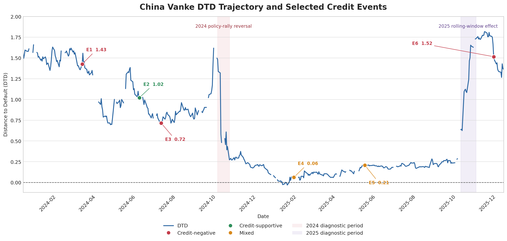

# China Vanke DTD Input Pipeline and Historical Signal Review

## Executive Summary

This submission has two connected parts. Part 1 implements a reproducible daily pipeline that appends one validated Distance-to-Default (DTD) input row at a time without rewriting the historical workbook. Part 2 evaluates the supplied historical DTD series against selected public credit events between 12 December 2023 and 12 December 2025.

The historical evidence suggests that DTD was informative about Vanke's broad credit deterioration, although its performance varied across events. The measure fell from approximately `1.57` at the start of the sample to around zero before the January 2025 loss, liquidity and leadership announcements. Completed bond repayments and shareholder loans, by contrast, were followed by only small or short-lived improvements. A material caveat appears in October 2025: DTD rose from `0.29` on 3 October to `1.73` on 31 October even though market capitalisation declined and the company's operating and refinancing position did not show a comparable improvement. A rolling-volatility diagnostic offers one possible explanation, but the supplied data are insufficient to confirm the model mechanism. These observations suggest that DTD may be more useful as one early-warning and escalation input alongside liquidity, maturity, bond-market and fundamental information than as a standalone default decision rule.

## 1. Part 1: Approach and Pipeline Design

### 1.1 Design

The pipeline separates ingestion, transformation, validation and output. `src/run_daily.py` is the daily entry point and `src/pipeline_core.py` contains the shared logic. Each invocation processes at most the next unprocessed market date, making state changes small and auditable. `src/run_replay.py` reuses the same transformations to reconstruct a date range in read-only mode.

The daily sequence is:

1. Load the current official workbook, or the original workbook if no output exists.
2. Find the first unprocessed date on which at least one Vanke listing traded.
3. Obtain A-share and H-share closes, CNY/HKD and the risk-free rate.
4. Align calendars without looking ahead.
5. Calculate combined market capitalisation in HKD millions.
6. Carry forward the latest balance-sheet observations.
7. Validate schema, dates, completeness and historical preservation.
8. Append one Input row and write Excel and CSV outputs.

The DTD calculation itself is outside the requested Part 1 scope. The pipeline prepares inputs and deliberately leaves the historical `Output` sheet unchanged.

### 1.2 Data Sources and Transformations

| Data | Assessment source | Transformation decision |
|---|---|---|
| Vanke A-share close (`000002.SZ`) | Tencent public market-data endpoint; local assessment snapshot after three failed requests | Multiply by fixed A-share count; convert CNY value to HKD |
| Vanke H-share close (`2202.HK`) | Tencent public market-data endpoint; local assessment snapshot after three failed requests | Multiply by fixed H-share count; already denominated in HKD |
| CNY/HKD | [HKMA daily exchange-rate API](https://api.hkma.gov.hk/public/market-data-and-statistics/monthly-statistical-bulletin/er-ir/er-eeri-daily) | Use direct HKD per CNY rate; latest observation on or before market date |
| Risk-free rate | [HKMA Exchange Fund Bills yield API](https://api.hkma.gov.hk/public/market-data-and-statistics/monthly-statistical-bulletin/efbn/efbn-yield-daily) | Use the 364-day (`efb_364d`) yield; latest observation on or before market date |
| Balance-sheet fields and historical DTD | Supplied `vanke_original.xlsx` | Carry balance-sheet values forward; never recalculate or overwrite historical DTD |

The combined market capitalisation is:

```text
CUR_MKT_CAP(HKD million)
= A-close(CNY) × A-share count × CNY/HKD ÷ 1,000,000
+ H-close(HKD) × H-share count ÷ 1,000,000
```

The A- and H-share trading calendars are treated as a union. If only one listing trades, its new close is combined with the other listing's latest available close. If neither trades, no row is created. FX and rate values are backward-looking as-of joins; a later value is never used for an earlier simulated date.

### 1.3 Controls, Assumptions and Limitations

Before writing an official result, the code checks column order, duplicates, missing values, chronological ordering, company number, and byte-level business equivalence of the original historical Input and Output frames. The supplied validator confirms 493 original Input rows, 493 untouched historical Output rows, five appended demonstration rows, no duplicates and no required missing values.

Key assumptions are:

- no new financial statement is released during the assessment update period;
- A- and H-share counts remain fixed at 9,724,196,533 and 2,206,512,938;
- the original workbook units and schema are authoritative;
- balance-sheet values can be carried forward until a new statement is available;
- a local fallback is used only after three failed live requests and is restricted to the simulated as-of date.

The public price endpoint and local snapshots are appropriate for a demonstration, not for a production service-level agreement. Production would require licensed data, corporate-action monitoring, scheduler/orchestrator controls, central logs, quality alerts, versioned storage and a controlled correction workflow. The current Excel/CSV state is transparent and easy to review but is less suitable than a database for concurrent or high-volume operation.

### 1.4 Trade-offs and Alternatives

| Choice made | Benefit | Trade-off / production alternative |
|---|---|---|
| One row per invocation | Clear daily state transition and idempotency | A catch-up batch is faster after an outage but needs stronger checkpointing |
| Backward as-of joins | Prevents look-ahead bias | Stale-data thresholds and exception queues would be added in production |
| Carry forward balance-sheet data | Matches the assignment and reporting frequency | A filing-aware process should replace values on their public release date |
| Public endpoint plus fallback | Re-runnable without credentials | Licensed feeds provide stronger provenance, adjustment handling and uptime |
| Excel and CSV outputs | Easy reviewer inspection | A database plus versioned object storage is safer for multi-user production |

Detailed operating instructions are in [`README.md`](README.md).

## 2. Part 2: Historical DTD Versus Credit Events

### 2.1 Method

The analysis uses the supplied sample from 12 December 2023 to 12 December 2025. Higher DTD is interpreted as greater distance from the default boundary and therefore lower model-implied credit risk. The workbook contains 493 dated rows, of which 469 have DTD values and 24 are missing. Missing DTD values are retained rather than interpolated.

Events were selected when they directly affected repayment capacity, liquidity, external ratings, earnings, management continuity or credible shareholder support. The list is representative rather than exhaustive, as permitted by the assignment. Each sub-event is assigned its own credit-impact judgment. Sub-events share one event-window ID only when they were disclosed on the same date or formed a tightly connected information cluster; this does not mean that their individual credit effects are treated as identical.

The event window uses valid DTD observations:

- `T-5`: fifth valid DTD observation before the event observation;
- `T`: valid DTD on the event date, or the latest valid observation on or before it;
- `T+1`: next valid DTD observation;
- `T+5`: fifth valid DTD observation after `T`.

`T+1` is included to observe the immediate market/model response, while `T+5` is used to judge whether that response persisted or reversed. These are observation-based rather than calendar-day windows. For example, E2's `T+1` is 11 June 2024 because the next dated row had a missing DTD and the intervening days included non-trading days; E4's `T+1` is 3 February 2025 because of a missing value and the Lunar New Year closure. The windows are descriptive and are not interpreted as causal estimates.

## 3. Full DTD Time Series



The blue line is the original DTD series. Red markers identify credit-negative events, green markers identify credit-supportive events, and orange markers identify mixed dates containing both risk exposure and external support. Missing DTD values remain blank and are not interpolated; the dashed line marks `DTD = 0`.

The chart and event-window table can be regenerated with:

```bash
python3 analysis/create_dtd_event_chart.py
```

### 3.1 Overall Time-Series Analysis

The full series can be divided into four broad phases:

1. **December 2023 to March 2024 — risk remained relatively contained but was gradually deteriorating.** DTD fell from `1.568` at the start of the sample to `1.427` on 11 March 2024. DTD did not change abruptly when Moody's removed the investment-grade rating, suggesting that the rating action may have largely confirmed pressure already observed by the market.
2. **April 2024 to January 2025 — structural deterioration and possible early warning.** DTD declined from around `1.0`, fell to approximately `0.27` after the October 2024 market reversal, and reached the sample minimum of `-0.031` on 17 January 2025. This low preceded the concentrated disclosure of a very large loss, management changes and liquidity difficulty on 27 January.
3. **February to September 2025 — remaining at a low level.** Shareholder loans, bond repayments and greater involvement by state-linked management reduced near-term payment risk, but DTD remained mostly within approximately `0.07–0.24`. The support measures did not lead the model to recognise a sustained and material credit repair.
4. **October 2025 to sample end — counter-intuitive rise followed by a decline.** DTD increased rapidly from `0.286` in October to approximately `1.73`, reaching the sample maximum of `1.817` on 13 November. It then fell after the 27 November bond-extension request and reached `1.364` on 12 December. The direction of the decline was consistent with extension risk, but the absolute level remained unusually high.

### 3.2 October 2024 Decline: Repricing of Market and Sector Risk

In late September 2024, China announced interest-rate and reserve-requirement cuts together with measures to support the property and equity markets, prompting a rapid rally in property shares. Vanke's combined market capitalisation increased from approximately HKD`86.98` billion on 24 September to HKD`227.78` billion on 2 October. DTD also rose from `1.109`, but while market capitalisation continued to surge on 2 October, DTD had already fallen from `1.619` on 27 September to `1.499`. This suggests that the higher volatility associated with the sharp rally may already have partly offset the benefit of a larger equity cushion. [Financial Times: September policy stimulus](https://www.ft.com/content/19fa5694-d26a-45bc-97eb-7aee2a589545)

The clearer break occurred on 8 October. The additional fiscal stimulus expected by the market was not announced, the Hang Seng Index fell 9.4%, and property shares were among the main declining sectors. [Financial Times: 8 October market reversal](https://www.ft.com/content/b38e6102-8e0f-4a4c-a73c-ea62ad7cda50) Vanke's combined market capitalisation in the supplied Input data fell by approximately 31.5% that day. The DTD path was:

`1.481 → 1.337↓ → 1.320↓ → 0.583↓↓ → 0.480↓ → 0.273↓`

The decline therefore appears more likely to reflect the combined repricing of policy optimism, the fall in Vanke's market capitalisation and higher estimated volatility, rather than one company-specific announcement. On 13 October, Vanke subsequently reported September contracted sales of RMB17.42 billion and no newly acquired development projects. This supports the persistence of credit pressure, but should not be treated as the cause of the initial 3–8 October decline. [Vanke September 2024 sales announcement](https://www.hkexnews.hk/listedco/listconews/sehk/2024/1013/2024101300071.pdf)

### 3.3 October 2025 Increase: Rolling-Window Effect Rather Than Fundamental Repair

The October 2025 pattern moved in the opposite direction:

- DTD: `0.286 → 0.636↑ → 1.094↑ → 1.466↑ → 1.733↑`;
- combined market capitalisation: approximately HKD`85.23` billion to HKD`76.33` billion;
- balance-sheet inputs were not updated before 29 October;
- the risk-free rate changed by only a few basis points.

No positive announcement identified during the initial rise appears sufficient to explain its size. Chairman Xin Jie resigned on 13 October and Vanke's shares fell 4.8% that morning; the company continued to face severe liquidity pressure, weak sales and reliance on Shenzhen Metro financing. [Wall Street Journal: October 2025 management change](https://www.wsj.com/business/china-vanke-chairman-xin-jie-resigns-6d6c7f93) Shenzhen Metro's shareholder loan of up to RMB2.2 billion announced on 30 October was credit-supportive, but DTD had already risen to `1.654` by 23 October. The loan may help explain only a limited part of the late-October move and does not explain the main increase beginning around 8 October. [Vanke 30 October shareholder-loan announcement](https://www.hkexnews.hk/listedco/listconews/sehk/2025/1030/2025103001928_c.pdf)

One potentially more informative mechanism is a rolling-window effect. The NUS-CRI methodology uses a recent one-year moving data window in DTD estimation and updates asset volatility daily. Other things equal, a lower estimated volatility would mechanically increase DTD. [NUS-CRI Technical Report 2023](https://d2.nuscri.org/static/pdf/Technicalreport_2023.pdf) A diagnostic volatility proxy calculated from 250 valid observations of combined-market-cap log returns fell from approximately `0.819` on 22 September 2025 to `0.319` on 31 October. Its contemporaneous correlation with DTD was approximately `-0.978`. The extreme returns from October 2024 left the window in sequence:

| Extreme 2024 return leaving the window | Approximate exit in 2025 | Corresponding DTD change |
|---|---|---|
| 2 October, log return approximately `+47.7%` | Around 8 October | `0.286 → 0.636↑` |
| 8 October, log return approximately `-37.9%` | 13–14 October | `0.625 → 1.094↑ → 1.113↑` |
| 16–17 October, approximately `+17.3% / -18.7%` | 21–22 October | `1.238 → 1.466↑ → 1.501↑` |
| 21 October, approximately `-15.3%` | 23–24 October | DTD increased to approximately `1.65` |

Because the data do not provide the model's implied asset value or asset volatility, this mechanism cannot be treated as direct proof of the precise internal calculation. However, the timing, direction and strong negative correlation are consistent with a rolling-window explanation. The October 2025 rise may therefore have been driven mainly by the model window and should not be interpreted directly as an improvement in repayment capacity. The signal may be mechanically explainable, but its economic interpretation could be misleading if considered without fundamental and refinancing information.

## 4. Key Events and Same-Date Sub-events

Sub-events occurring on the same date are assessed separately for credit impact but share one DTD event window, avoiding repeated measurement of the same market-information period.

| ID | Date | Sub-event | Credit classification | Rationale |
|---|---|---|---|---|
| E1 | 2024-03-11 | Moody's withdrew the Baa3 investment-grade issuer rating and assigned a Ba1 corporate family rating | Credit-negative | Formal confirmation of weaker credit quality and funding capacity |
| E2 | 2024-06-05 to 06 | Vanke remitted USD612.6 million to repay principal and interest on the USD bond due 7 June | Credit-supportive | Removed the immediate payment risk on the final USD-bond maturity of the year |
| E3 | 2024-07-09 | Expected first-half 2024 attributable net loss of RMB7–9 billion | Credit-negative | Material deterioration in earnings, asset quality and internal cash generation |
| E4-a | 2025-01-27 | Expected FY2024 attributable net loss of approximately RMB45 billion | Credit-negative | Large loss weakened the capital buffer and market funding confidence |
| E4-b | 2025-01-27 | Chairman resigned | Credit-negative | A change in the highest governance role during a crisis increased execution and governance uncertainty |
| E4-c | 2025-01-27 | President and CEO resigned | Credit-negative | Departure of the principal operating executive reinforced the indication that the company was in crisis-management mode |
| E4-d | 2025-01-27 | Company formally acknowledged temporary liquidity difficulty | Credit-negative | Directly related to short-term debt payment and refinancing capacity |
| E4-e | 2025-01-27 | Shenzhen Metro chairman Xin Jie became Vanke chairman and introduced greater state-linked involvement | Credit-supportive | Increased expectations of shareholder coordination, financing support and avoidance of a disorderly default |
| E5-a | 2025-05-12 to 15 | Repaid approximately USD423 million of offshore notes | Credit-supportive | Completed payment of a maturing public debt obligation |
| E5-b | 2025-05 | Shenzhen Metro provided an approximately RMB1.552 billion shareholder loan | Credit-supportive | Directly supplemented payment liquidity, while also indicating reliance on shareholder support |
| E5-c | 2025-05-14 | Fitch downgraded Vanke to CCC+ and Vanke Hong Kong to CCC | Credit-negative | Rating agency assessed liquidity and refinancing risk as continuing to rise |
| E6-a | 2025-11-26 to 27 | Proposed delaying for one year the principal of a RMB2 billion onshore bond due 15 December | Credit-negative / Near-default | First explicit request to defer principal on public debt, indicating severe liquidity pressure |
| E6-b | 2025-11-28 | S&P further downgraded Vanke to CCC- | Credit-negative | Rating confirmation of extension and non-payment risk |

E4 and E5 are marked `Mixed` overall not because the direction of their sub-events is unclear, but because the same information period contained both explicit credit-negative and credit-supportive developments.

Sources include the [March 2024 repayment announcement](https://www.hkexnews.hk/listedco/listconews/sehk/2024/0308/2024030801255.pdf), [Moody's downgrade reporting](https://www.ft.com/content/e2cfc041-1eef-4a2b-95ba-050e32ba64a5), [June 2024 repayment reporting](https://www.cs.com.cn/ssgs/gsxw/202406/t20240606_6415393.html), [July 2024 profit alert](https://www1.hkexnews.hk/listedco/listconews/sehk/2024/0709/2024070900939.pdf), [January 2025 profit alert](https://www.hkexnews.hk/listedco/listconews/sehk/2025/0127/2025012700444.pdf), [January management announcement](https://www.hkexnews.hk/listedco/listconews/sehk/2025/0127/2025012700298.pdf), [May 2025 event reporting](https://bondblox.com/news/china-vanke-repays-dollar-bond-receives-215mn-loan-downgraded-to-ccc-by-fitch), [May 2025 Fitch action](https://www.fitchratings.com/research/corporate-finance/fitch-downgrades-china-vanke-to-ccc-vanke-hong-kong-to-ccc-14-05-2025), [November extension reporting](https://www.wsj.com/world/china/vankes-bid-to-delay-bond-payment-sparks-selloff-in-chinese-developers-f4ccf484) and [S&P's CCC- action](https://www.spglobal.com/ratings/en/regulatory/article/-/view/sourceId/101660200).

## 5. Event-Window Results

| Event | Classification | DTD path: T-5 → T → T+1 → T+5 | Assessment |
|---|---|---|---|
| E1 Moody's downgrade | Credit-negative | `1.405 → 1.427↑ → 1.557↑ → 1.362↓` | Short-term counter-move; deterioration visible by T+5 |
| E2 USD bond repayment | Credit-supportive | `1.063 → 1.022↓ → 1.027↑ → 0.927↓` | T+1 broadly flat; repayment did not reverse the downtrend |
| E3 H1 loss warning | Credit-negative | `0.808 → 0.717↓ → 0.692↓ → 0.784↑` | Deterioration before and immediately after the event; partial T+5 reversal |
| E4 January crisis/support cluster | Mixed | `0.001 → 0.062↑ → 0.060↓ → 0.074↑` | Very low pre-event level; limited change after the mixed announcements |
| E5 repayment/loan/downgrade cluster | Mixed | `0.182 → 0.208↑ → 0.200↓ → 0.200↑` | T+1 and T+5 were effectively flat as opposing information may have offset |
| E6 bond-extension request | Credit-negative | `1.808 → 1.515↓ → 1.478↓ → 1.344↓` | Direction aligned from T through T+5, but the pre-event level remained unusually high |

The exact window dates and six-decimal values are in [`docs/event_window_analysis.csv`](docs/event_window_analysis.csv).

## 6. Event-by-Event Interpretation

**E1 — Moody's downgrade.** DTD increased slightly from `1.405` at T-5 to `1.427` on 11 March and then to `1.557` at T+1 on 12 March. It would therefore be too simple to describe the response only as lagging. Vanke had just funded and completed a major March bond repayment, while combined market capitalisation increased by approximately 6.3% from 11 to 12 March. Repayment relief and the equity-market move may have temporarily outweighed the rating news in the model inputs. By T+5, DTD had fallen to `1.362`, which is directionally consistent with the negative rating action. This interpretation remains tentative because several pieces of information were being processed at the same time.

**E2 — June bond repayment.** DTD declined from `1.063` at T-5 to `1.022` on 6 June. The next valid DTD observation was 11 June, when it increased only slightly to `1.027`, before falling to `0.927` at T+5. The repayment was credit-supportive because it removed an immediate maturity, but it was expected and did not resolve the broader sales, leverage and refinancing pressures. The small T+1 change and subsequent decline suggest that the supportive event did not materially reverse the existing risk trend.

**E3 — first-half loss warning.** DTD had already fallen to `0.808` at T-5, declined to `0.717` on 9 July and fell further to `0.692` at T+1 on 10 July. This pattern suggests that weakening credit conditions were visible before the announcement and continued immediately afterwards. DTD recovered to `0.784` by T+5, so the local decline was only partly persistent; it nevertheless remained below the levels observed earlier in 2024.

**E4 — 27 January 2025.** The loss warning, the chairman and CEO resignations, and the acknowledgement of liquidity difficulty are assessed separately as credit-negative. Shenzhen Metro's more direct involvement is assessed as credit-supportive, making the overall date a mixed cluster. DTD had already reached `-0.031` on 17 January and was `0.001` at T-5 on 20 January. This suggests that the model had already reflected broad distress before the public announcements. DTD was `0.062` at T, `0.060` at the next valid observation on 3 February and `0.074` at T+5. These small movements, all from a very low base, may reflect support expectations offsetting bad news that was already partly priced, rather than a clear post-event improvement.

**E5 — May repayment, loan and downgrade.** DTD rose from `0.182` at T-5 to `0.208` on 15 May, then moved to `0.200` at T+1 and remained at approximately `0.200` at T+5. The repayment and shareholder loan reduced immediate liquidity risk, while the CCC-range downgrade pointed to continued underlying weakness. The nearly flat T+1 and T+5 readings are consistent with these opposing effects offsetting each other, although the data do not identify their separate contributions.

**E6 — November extension request.** DTD fell from `1.808` at T-5 to `1.515` on 27 November, `1.478` at T+1 on 28 November and `1.344` at T+5. The direction is consistent with the extension request and subsequent downgrade, and the T+1/T+5 observations show that the decline persisted. However, the starting level was unusually high for a company about to request a maturity extension. The signal therefore appears to have reacted around the event, but its pre-event level did not provide a strong warning of the short-term refinancing risk.

## 7. Direct Answers to the Questions

### 7.1 Did DTD Anticipate, Coincide With or Lag Credit Distress?

- **Anticipatory:** the July 2024 loss warning and the January 2025 crisis point. In January 2025 in particular, DTD was already close to zero and briefly negative before the formal disclosures.
- **Coincident:** the October 2024 policy-market reversal and the November 2025 bond-extension request. DTD and market capitalisation fell as bond-market risk increased.
- **Insufficient response:** the June 2024 and May 2025 repayments and shareholder support produced only limited improvement. These measures addressed near-term payment obligations rather than the overall balance sheet and operating problems.
- **Not consistently classifiable as simply lagging:** the small increase around the E1 rating date had the clear background of a preceding bond repayment. For E6, the issue was not that DTD declined only after the event, but that its pre-event absolute level may have been distorted by the window effect.

### 7.2 Were There Noisy, Muted or Counter-intuitive Periods?

- **Noisy:** in late September and early October 2024, policy expectations caused market capitalisation to rise and fall sharply. DTD was affected by the opposing effects of a larger equity cushion and higher volatility, producing substantial short-term movement.
- **Muted:** repayment of an individual bond did not materially increase DTD, possibly because the payment had already been anticipated and the company's broader liquidity and earnings pressure remained.
- **Counter-intuitive:** October 2025 was the clearest counter-intuitive period. DTD increased sharply even though market capitalisation declined, operating losses continued and Vanke subsequently requested a bond extension. One relatively informative explanation is that the previous year's extreme returns exited the rolling-volatility window, rather than that fundamentals improved.

## 8. Assumptions and Limitations

1. The sample covers only one company and cannot be used to assess the overall accuracy of the DTD model.
2. Of 493 daily records, 469 contain valid DTD values and 24 are missing. Missing values are not interpolated.
3. Public disclosure dates may differ from the dates on which the market first learned or anticipated the information. After-close announcements can also create a one-trading-day alignment difference.
4. The data do not provide the complete DTD formula, implied asset value, asset volatility or intermediate default-point results. The October 2025 window effect is therefore an inference with some supporting evidence rather than a direct validation of internal model parameters.
5. `T-5 / T / T+1 / T+5` are used only to describe short-term changes consistently; they cannot establish that a news event caused a DTD movement.
6. Government and shareholder support has a dual interpretation: it may reduce the actual probability of default, while also indicating that the company cannot rely fully on its own cash flow and market-based financing.
7. No contemporaneous peer DTD series was available. Industry comparison is therefore limited to property-market and bond-market context rather than a quantitative cross-sectional ranking.
8. The sample ends on 12 December 2025. Subsequent bondholder meetings, grace periods and realised near-default outcomes can be used only as out-of-sample validation and cannot be treated as information already available to the model within the sample.

## 9. Conclusion

From mid-2024 to early 2025, Vanke's DTD appears to have reflected reasonably well the longer-term progression from weakening profitability to liquidity stress, and it provided a relatively clear warning before the major January 2025 crisis disclosures. However, the model's response to individual bond repayments and shareholder loans was limited, and its identification of short-term refinancing risk in late 2025 also showed material limitations. In particular, the unusual October 2025 rise suggests that the rolling-volatility window may mechanically increase DTD even when fundamentals have not improved.

DTD can therefore be used as one market-based structural indicator within a broader credit-monitoring framework, with attention paid to its level, trend, persistence and divergence from market capitalisation, volatility and observed events. When DTD rises unusually, the rolling window, financial-input updates, bond prices, near-term maturities and shareholder support should also be reviewed; a higher DTD should not automatically be interpreted as evidence that default risk has declined.
